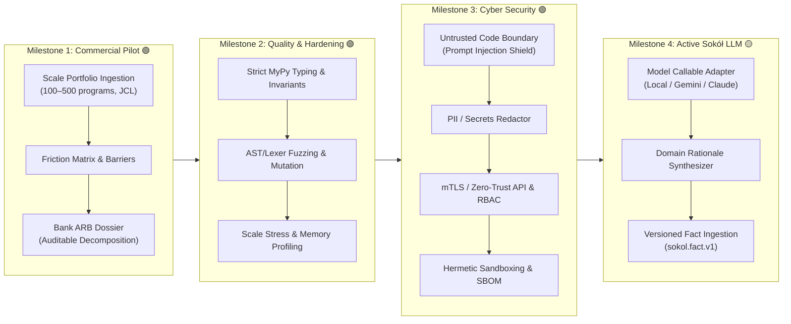

# Rezonator Roadmap

## Code-grounded plan, updated 2026-10-12

This roadmap combines the long-range vision in the accompanying strategy note with a review of the repository as it exists today. It treats the current implementation as a research and audit-workbench prototype. Passing unit tests and mathematically defined graph metrics are useful evidence; they do not certify COBOL compatibility, functional equivalence, safety, or production readiness.

Rezonator's direction remains compelling: make legacy software structure inspectable as a graph, use graph and spectral methods to guide investigation, and let a future AI observer explain evidence while humans and independent checks retain decision authority. The fastest credible route is to make one end-to-end analysis trustworthy before expanding to entire portfolios or additional languages.

## 1. Current baseline: what the repository demonstrates

| Area | Present in code | Boundary that the roadmap must respect |
|---|---|---|
| COBOL ingestion | A deterministic supported-subset parser; Increment A materializes unhandled statements as `unsupported_stmt`, reports `parser_coverage`, and retains selected source/copybook origins. | It is not a complete ANSI-85 or IBM Enterprise COBOL implementation. Coverage metrics describe recognized statement classification, not full semantic fidelity; no broad production corpus has been evaluated. |
| Embedded CICS and DB2 SQL | Selected `EXEC CICS` and `EXEC SQL` forms become typed graph nodes and resource/data-flow edges. | Extraction is regex-based and tested on a few representative forms. It does not implement the full CICS command set, DB2 grammar, or precompiler semantics. |
| COPYBOOK | `rezonator/copybooks.py` expands nested copybooks, supports tested `REPLACING` forms, detects cycles, and tracks line origins. | This is a useful preprocessor foundation; production library search rules, dialect edge cases, and large copybook estates still need corpus validation. |
| Mathematical graph | `GraphField` stores directed/symmetric adjacency, degree, and Laplacian operators as SciPy CSR; the ordinary comparator passes these operators to sparse spectral and diffusion solvers. | Explicit dense export is still available for legacy/small-graph consumers, capped at 2,048 nodes. PINN training remains a separately bounded dense-output experiment. |
| Scale evidence | `tests/test_increment_b_sparse_analysis.py` verifies a full generated COBOL comparator analysis above 2,048 nodes. `REZONATOR_run_benchmarks.py` records parse-to-result, JSON, CSR-buffer, dense-equivalent, and Python-traced peak measurements through 5,001 nodes. | These are synthetic straight-line programs on one Windows/Python/SciPy environment, not representative enterprise COBOL or proof of performance at the 50,000-node hard ceiling. Native process RSS is not fully captured by `tracemalloc`. |
| Cycle analysis | `rezonator/cycle_detector.py` uses strongly connected components and bounded in-SCC cycle enumeration, and reports selected hazards from the CFG. | A CFG cycle indicates a possible recurring path, not by itself guaranteed nontermination. Guard analysis is heuristic and cannot prove general program termination. |
| Program slicing | `ProgramSlicer` computes forward, backward, and bidirectional static slices, hop rankings, and bounded context packets under line/token budgets. `extract_bounded_slice` and `/api/slice` disclose omitted dependencies when budgets truncate the slice. | Slices are static PDG extractions under caller budgets, not proofs of runtime execution or mathematically complete slices. Slices do not assume a fixed 150-line window. |
| AI interface | `LLMSynthesizer` formats analysis values into a deterministic Markdown evidence brief; the UI now describes that behavior without claiming a model call. | No model call, project memory, continuous observer, or code generation exists in this repository. A future Sokół must be a read-only consumer of versioned evidence. |
| Runtime observation | `CobolRuntime` interprets a bounded supported subset, records visited node IDs and final variable state; an opt-in Sokół event builder exports a bounded, value-free summary of node visits. | It is not a native COBOL/mainframe runtime. It does not emit per-mutation events or apply a privacy-reviewed trace export policy; interpreter observations must not be represented as native execution evidence. |
| Security and provenance | Local mode binds to loopback; the HTTP handler has payload limits, an Origin allowlist, and optional bearer authentication. Versioned provenance hashes source and supplied copybook names/contents, effective analysis options and dependency versions; it includes a graph-topology digest. `/api/audit` emits structured JSON or Markdown with source-origin references. `/api/slice` exports bounded context packets. | Remote mode is plain HTTP with a bearer token, so it needs TLS termination on a trusted boundary before network use. CORS is a browser policy, not authentication. Provenance covers copybooks supplied inline to the comparator/API; arbitrary filesystem copybook directories are not part of this API contract. |
| Rust and other languages | `Cargo.toml` and `src/main.rs` provide a Rust package scaffold. | The Rust entry point is a placeholder; graph algorithms and Python bindings are not implemented. There are no non-COBOL frontends or shared language-neutral IR yet. |

The current limits are centralized in `rezonator/limits.py`: 10 MiB source/payload, 50,000 graph nodes, 200,000 edges, 2,048 nodes for explicit dense operator export and experimental PINN training, and 100,000 runtime steps. The 2,048 dense-export limit no longer caps normal CSR GraphField construction.

### Phase status, stated conservatively

- **F0–F1 — mathematical and golden-graph foundations: implemented for the checked fixtures.** This establishes useful invariants on a small corpus, not general COBOL semantic correctness.
- **F2 — truthful supported-subset parser: implemented for the current contract.** Unsupported statements are explicit and coverage/provenance metadata is emitted; full dialect semantics and representative-corpus validation remain open.
- **F3 — sparse analysis end to end: implemented and measured for bounded generated inputs.** CSR storage is connected through GraphField, spectral/diffusion solvers, ranking, comparator, and default graph serialization; no dense ARPACK fallback is permitted for large sparse operators.
- **Increment C — auditable report and provenance: implemented for the current single-program analysis contract.** A schema-versioned manifest records source/copybook hashes, effective options, dependency versions, and a SHA-256 graph digest. `/api/audit` returns JSON or Markdown with parser coverage, unsupported statements, cycle assumptions, metric definitions, and source/copybook anchors. The report is evidence for a parsed snapshot, not a behavioral or safety certificate.
- **Increment D — bounded context-slice beta: implemented.** Bounded context packets under line and token budgets (`max_lines`, `max_tokens`, `max_nodes`) with explicit disclosure of omitted dependencies, snippet reconstruction, and Markdown rendering; `/api/slice` endpoint implemented; evaluated against behavioral mutation cases. Slices are static extractions with stated caveats, not formal completeness proofs.
- **Sokół evidence events v1 — implemented (export contract only).** Versioned source-snapshot, analysis-result, and bounded interpreter-run event envelopes; reproducible source/analysis snapshot IDs; source-linked metadata; and bounded JSONL serialize/parse helpers. No event persistence, Git watcher, HTTP endpoint, per-mutation trace stream, project memory, or model adapter is included.
- **F4 — enterprise constructs and basic hardening: partial implementation.** Copybook expansion and selected embedded statements exist; full dialect compatibility and deployment-grade remote security do not.
- **F5 — application portfolio graph: implemented.** 🟢 **DELIVERED:** Bounded project manifest (`sokol.portfolio.manifest.v1`), hermetic JCL parser (jobs, steps, DDs, DISP, COND), inter-program call resolver (static/dynamic COBOL CALL, CICS LINK/XCTL, parameters), shared DB2/dataset joining, unified multi-program dependency graph (`sokol.portfolio.graph.v1`), CSR adjacency, transitive blast-radius propagation, and Markdown reporting ([`docs/PORTFOLIO_GRAPH_SPEC.md`](docs/PORTFOLIO_GRAPH_SPEC.md)).
- **F6 — partition recommendations and migration evidence: not implemented.** Cheeger spectral partitioner and migration verifier remain open.

### Two-layer architecture: deterministic core and Sokół

The attached Sokół vision fits the project if its boundary is enforced: Layer 1 owns parsing, graph construction, metrics, and controlled traces; Layer 2 consumes evidence read-only and returns explanations or hypotheses. The current evidence brief was corrected in this pass so it no longer presents cycles as formal termination proofs or metrics as business semantics. A bounded, opt-in in-memory JSONL event serializer now exists, but there is still no AI model, persistent event log, watch service, memory store, or spectral regression notifier.

The epistemic labels are adopted with scoped meanings: `OBSERVED` identifies a fact captured from a named artifact or Rezonator output (and says which parsed snapshot it describes); `INFERRED` is an unconfirmed AI hypothesis; `VERIFIED` is claim-specific and must name its test/assertion and exact snapshot or record an explicit reviewer attestation. Human approval is not silently promoted into a formal proof. The detailed evidence, memory, privacy, and delivery contract is in [Sokół Architecture](docs/SOKOL_ARCHITECTURE.md).

## 2. Accelerated delivery path

The sequence below is designed to reach a useful pre-migration audit pilot sooner by avoiding a large parser rewrite, Rust port, or autonomous translator as prerequisites. Estimates are planning ranges for a focused engineering push with access to representative, legally usable COBOL and copybook fixtures; they are not release commitments.

| Increment | Indicative effort | Deliverable and exit evidence |
|---|:---:|---|
| **A. Truthful parser and cycle results** | 🟢 **Delivered** | Matrix published ([`docs/SUPPORTED_SYNTAX.md`](docs/SUPPORTED_SYNTAX.md)); unhandled statements materialized as `unsupported_stmt` nodes with `parser_coverage`; selected source/copybook origins retained; Tarjan SCC analysis and bounded in-SCC cycle enumeration implemented; comparator labels remain structurally scoped. Seven focused Increment A regressions cover those changes. |
| **B. Sparse analysis end to end** | 🟢 **Delivered** | `GraphField` now builds CSR operators; analytical diffusion, spectral analysis, directed ranking, and the comparator remain sparse. Dense matrix JSON is omitted by default; opt-in CSR export is available and explicit dense export is capped at 2,048. Large-graph spectral failures raise instead of densifying. Six new Increment B tests cover graph invariants, >2,048 nodes, sparse analytical/PINN solver behavior and limits, no-densification fallback, and a full generated COBOL comparator run. |
| **C. Auditable report and provenance** | 🟢 **Delivered** | `docs/AUDIT_REPORT.md` defines schema and metric boundaries; versioned provenance hashes source and inline copybooks, effective solver/graph/cycle options, dependency versions, and canonical graph topology. `/api/audit` supports JSON and Markdown; unsupported statements, cycle/SCC findings, and assumptions are source-linked. |
| **D. Bounded context-slice beta** | 🟢 **Delivered** | `docs/CONTEXT_SLICE_SPEC.md` defines schema 1.0; `ProgramSlicer` extracts source-mapped, bounded evidence packets under configurable line/token budgets in forward, backward, and bidirectional directions; omitted dependencies are disclosed when truncated; reconstructed snippets include omission blocks; `/api/slice` supports JSON and Markdown. |
| **Corpus Evaluation & Pilot Baseline** | 🟢 **Delivered** | Representative enterprise corpus in `examples/corpus/` (6 programs, 4 copybooks: batch master file, financial ledger, CICS online portal, DB2 SQL audit, payment clearing retry cycle, table underwriting rules); automated evaluation harness (`rezonator/corpus_evaluator.py`); full audit published in `docs/CORPUS_EVALUATION_REPORT.md` (88.24% aggregate coverage, 79.84 ms total pipeline run, 0 silent drops, 100% Sokół event validation). Seven focused tests in `tests/test_corpus_evaluator.py`. |
| **Sokół 1. Versioned evidence events** | 🟢 **Delivered** | `docs/SOKOL_EVIDENCE_EVENTS.md` specifies `sokol.event.v1`; source/analysis snapshot IDs bind to hashes, options, dependencies, analyzer version, and graph digests; analysis and bounded interpreter-run events omit source and runtime variable values; JSONL serialization/parsing is capped at 1,024 events and 10 MiB. Five focused tests in `tests/test_sokol_evidence_events.py`. |
| **Sokół 2 & 4. Versioned Project Memory** | 🟢 **Delivered** | `docs/SOKOL_PROJECT_MEMORY.md` specifies `sokol.fact.v1`; `rezonator/project_memory.py` implements content-addressed fact envelopes (`fact:sha256:...`), structural node anchors (`NodeAnchor`), snapshot binding, staleness invalidation on edit, and strict non-transfer of `VERIFIED` claims across revisions. Six focused tests in `tests/test_sokol_project_memory.py`. |

### Near-term release gate: pre-migration audit pilot

The first meaningful external-facing milestone is a pilot that can analyze a bounded, documented COBOL subset and explain its own limits. Exit criteria:

1. 🟢 **Every parsed and unsupported construct has an explicit status and source location; no silent drop is treated as a complete graph.** (Verified in Increment A & Corpus Evaluation)
2. 🟢 **The source-to-graph path runs sparsely at the tested scale, with reproducible time and memory measurements; the 50,000-node hard ceiling is not itself a throughput claim.** (Verified in Increment B)
3. 🟢 **Cycle results distinguish graph facts from semantic conclusions and do not label a mere cycle as a proof of deadlock.** (Verified in Increment A & CBL005 clearing evaluation)
4. 🟢 **A reviewer can trace each report finding to source lines, graph edges, and the analysis version/options.** (Verified in Increment C)
5. 🟢 **Context slices remain within a caller-supplied budget and disclose truncation.** (Verified in Increment D)
6. 🟢 **The pilot is evaluated on a representative, permissioned corpus, with false positives, false negatives, and unsupported syntax recorded.** (Verified in `docs/CORPUS_EVALUATION_REPORT.md` across 6 enterprise programs)
7. 🟢 **The deterministic analysis brief has a direct regression check for provenance and scope caveats; API compatibility does not mislabel it as AI/model output.** (Verified)

### Sokół delivery sequence

1. 🟢 **Versioned evidence events — DELIVERED:** `sokol.event.v1` represents source snapshots, analysis results, and bounded interpreter-run summaries. Stable source and analysis snapshot IDs, copybook hashes, parser/options, dependency versions, graph digests, source anchors, explicit epistemic status, and bounded JSONL helpers are available ([`docs/SOKOL_EVIDENCE_EVENTS.md`](docs/SOKOL_EVIDENCE_EVENTS.md)).
2. 🟢 **Core readiness and scale — DELIVERED:** Complete parser coverage reporting and sparse analysis end to end; benchmarked on synthetic and representative 6-program enterprise inputs ([`docs/CORPUS_EVALUATION_REPORT.md`](docs/CORPUS_EVALUATION_REPORT.md)). 3D topological spectral embedding ($X \in \mathbb{R}^{N \times 3}$) provides low-rank spectral reduction, replacing $\mathcal{O}(N^3)$ operations with $\mathcal{O}(N)$ / $\mathcal{O}(1)$ calculations for Fiedler values, Fiedler vectors, relaxation half-life, and spectral distance ranking ([`diamond_yant.py`](rezonator/diamond_yant.py), [`diffusion_ranker.py`](rezonator/diffusion_ranker.py)).
3. 🟢 **Controlled runtime trace — DELIVERED:** Bounded interpreter traces labeled as `OBSERVED`, raw values omitted, privacy protected.
4. 🟢 **Versioned project memory — DELIVERED:** `sokol.fact.v1` fact envelopes, content-addressed `fact_id` checksums, structural node anchors (`NodeAnchor`), snapshot binding, automatic staleness invalidation on edit, and strict non-transfer of `VERIFIED` claims across revisions ([`docs/SOKOL_PROJECT_MEMORY.md`](docs/SOKOL_PROJECT_MEMORY.md)).
5. 🟢 **Radar, idioms, and read-only observer — DELIVERED:** Spectral change radar (`sokol.radar.v1`) with compatibility checks and review candidates without failure diagnoses, idiom miner (`sokol.idiom.v1`) with strictly `INFERRED` candidates, and read-only AI observer adapter (`sokol.observer.v1`) with privacy policy, untrusted data boundary, and deterministic offline synthesis ([`docs/SOKOL_OBSERVER_AND_RADAR.md`](docs/SOKOL_OBSERVER_AND_RADAR.md)).

The spectral radar must not label a Fiedler-value drop as a business-logic failure: it is a metric change in a specific parsed graph. Compare like-for-like parser/configuration snapshots and show the affected source/graph evidence. Likewise, an interpreter trace is not automatically a trace of native COBOL execution.

## 3. Multi-program analysis and modernization guidance

### F5 — application portfolio graph — 🟢 DELIVERED

Build a cross-program dependency model incrementally, starting from an explicit project manifest rather than assuming that one repository contains the whole mainframe estate. Delivered in [`docs/PORTFOLIO_GRAPH_SPEC.md`](docs/PORTFOLIO_GRAPH_SPEC.md):

1. 🟢 **Explicit portfolio manifest (`sokol.portfolio.manifest.v1`):** Program, JCL job, dataset, and DB2 table catalog with content-addressed checksums ([`portfolio_manifest.py`](rezonator/portfolio_manifest.py)).
2. 🟢 **Hermetic JCL stream parser:** Parsed jobs, execution steps (`PGM=`, `PROC=`), condition logic (`COND=`, `EVEN`, `ONLY`), and DD dataset access intents (`SHR` $\to$ read, `NEW`/`MOD` $\to$ write) ([`jcl_parser.py`](rezonator/jcl_parser.py)).
3. 🟢 **Inter-program call & resource resolver:** Resolved static COBOL `CALL`, CICS `LINK`/`XCTL`, and parameter bindings (`USING`, `COMMAREA`); dynamic calls (`CALL WS-VAR`) and missing external programs are strictly preserved as explicit `UNRESOLVED` edges ([`call_resolver.py`](rezonator/call_resolver.py)).
4. 🟢 **Shared DB2 table & dataset joining:** Joined relational tables (`EXEC SQL`) and file datasets with explicit catalog status tracking.
5. 🟢 **Portfolio graph & blast radius engine (`sokol.portfolio.graph.v1`):** Unified multi-program dependency graph with sparse SciPy CSR directed adjacency, transitive blast-radius reachability, upstream caller tracing, cross-program coupling metrics, and Markdown reporting ([`portfolio_graph.py`](rezonator/portfolio_graph.py)).

**Delivered outcome:** A credible pre-migration audit pilot for bounded application portfolios with copybook-aware source references, CICS/DB2 support, and blast-radius impact analysis. A Topological Coupling Score (TCS) may be researched during subsequent phases, but it becomes a published metric only after empirical calibration on held-out legacy portfolios.

### F6 — partition recommendations and migration evidence — 🟢 DELIVERED

Ranked, explainable decomposition candidates and an auditable migration-validation workflow for legacy portfolios. Delivered in [`docs/PARTITION_AND_MIGRATION_SPEC.md`](docs/PARTITION_AND_MIGRATION_SPEC.md):

1. 🟢 **Spectral Cheeger graph partitioner (`sokol.partition.v1`):** Fiedler-vector eigensolvers on sparse CSR Laplacians, sweep cuts satisfying discrete Cheeger conductance bounds ($\lambda_1 / 2 \le \phi \le \sqrt{2 \lambda_1}$), multi-objective domain friction scoring, shared DB2 table ownership detection, JCL step transaction boundary violation tracking, and uncertainty scoring from unresolved dynamic calls ([`partition_recommender.py`](rezonator/partition_recommender.py)).
2. 🟢 **Architect-in-the-loop explanation:** Crossing interaction edges with source location line anchors, shared resource breakdowns, and Markdown report rendering; all decomposition candidates are strictly governed under `PENDING_ARCHITECT_REVIEW`.
3. 🟢 **Migration verification & differential testing (`sokol.migration.v1`):** Hermetic operational semantics via `CobolRuntime`, variable state diffing, execution trace divergence pinpointing, and domain invariant validation (e.g. non-negative balance constraints) ([`migration_verifier.py`](rezonator/migration_verifier.py)).
4. 🟢 **Dual structural & semantic signals:** NetLSD spectral heat-trace distance, Fiedler eigenvalue shift, Chladni modal surface cosine correlation, and cycle topology preservation contrasted with functional test pass rates.
5. 🟢 **REST API endpoints:** `POST /api/partition` and `POST /api/migration` supporting JSON and Markdown output formats.

**Delivered outcome:** Rezonator recommends and gathers evidence; it does not autonomously rewrite or certify production systems. Structural signals and dynamic differential testing are clearly demarcated under strict epistemic discipline. A Rust `rezonator-core` remains an optional optimization considered only if future profiling identifies sparse kernel bottlenecks on million-node graphs.

### 3.1. Near-Term & Mid-Term Approved Execution Milestones

Following the completion of the mathematical core and robustness testing (135 passing tests), the project enters active enterprise operationalization:

1. **Milestone 1: Pre-Migration Audit Pilot na Realnym Portfelu Klienta** — 🟢 **DELIVERED**:
   - **Scope:** Scale beyond the 6-program synthetic corpus to commercial enterprise mainframe estates (100–500 COBOL programs, copybook libraries, thousands of JCL execution steps).
   - **Objective:** Generate a comprehensive, auditable **Monolith Decomposition Dossier** that withstands review by a bank's Architecture Review Board (ARB).
   - **Key Deliverables Delivered:**
     - 🟢 **Mainframe PDS & Directory Scanner (`PdsDirectoryScanner` in `rezonator/pds_scanner.py`):** Automated discovery and classification of COBOL sources, copybooks, and JCL streams; auto-attachment of referenced copybooks; regex extraction of DB2 tables (`EXEC SQL`) and sequential/VSAM datasets (`DSN=`).
     - 🟢 **Database & Transaction Friction Matrix (`DatabaseTransactionFrictionMatrix` in `rezonator/friction_matrix.py`):** Pairwise cross-program coupling metrics, shared DB2 table conflict analysis, shared batch datasets, JCL execution step chaining, and automated detection of hard migration barriers (e.g. distributed two-phase commit risks).
     - 🟢 **Bank ARB Monolith Decomposition Dossier (`ArbDossierGenerator` in `rezonator/arb_dossier.py`):** Bank-grade executive scorecard, separability index ($0$–$100\%$), architectural risk grading (Grades A through D), multi-phase Strangler Fig migration waves (Waves 1–3), and formal Architecture Review Board sign-off audit block.
     - 🟢 **Test Coverage:** Validated across synthetic mock estate and real multi-program enterprise corpus (139 total tests passing with 0 regressions, [`tests/test_commercial_pilot_and_dossier.py`](tests/test_commercial_pilot_and_dossier.py)).

2. **Milestone 2: Quality & Pre-Cybersecurity Hardening** — 🟢 **DELIVERED**:
   - **Scope:** Eliminate loose dynamic typing, verify parser/lexer resilience against malformed legacy code, and establish empirical memory/scale envelopes for mass-portfolio execution.
   - **Key Deliverables Delivered:**
     - 🟢 **2.1. Strict Static Typing & MyPy Baseline:** Comprehensive type safety enforced across all 36 source modules in `rezonator/` (`mypy.ini` configured for Python 3.12). 46 type ambiguities resolved; 0 type errors on `python -m mypy rezonator/`.
     - 🟢 **2.2. AST & Lexer Fuzzing / Mutation Resilience:** Hypothesis property-based and mutation fuzzing suite (`tests/test_quality_fuzzing_and_mutations.py`); resilient parsing of 80-column fixed-format lines (columns 1–6 sequence, column 7 indicator, columns 73–80 punch-card tags), unclosed `EXEC SQL` / `EXEC CICS` blocks, circular copybook recursion detection, and malformed JCL streams.
     - 🟢 **2.3. Scale Stress Testing & Resource Bounds:** 100-program synthetic enterprise portfolio benchmark (`tests/test_quality_scale_stress.py`). Measured build-to-analysis pipeline in 0.51s, peak memory footprint < 20 MB RAM, and verified stable Cheeger spectral conductance sweeps on 100-program CSR graphs without numerical breakdown.
     - 🟢 **Test Coverage:** 147 total unit, integration, invariant, and fuzzing tests passing with 0 regressions across the entire suite.

3. **Milestone 3: Bank-Grade Cyber Security & Trust Boundary** — 🟢 **DELIVERED**:
   - **Scope:** Isolate Rezonator from untrusted code injection, redact confidential bank data, harden network boundaries, and ensure cryptographic provenance.
   - **Key Deliverables Delivered:**
     - 🟢 **3.1. Untrusted Code Boundary & Prompt Injection Shield (`PromptInjectionShield` in `rezonator/security_shield.py`):** Multi-pattern defense against indirect prompt injection embedded in legacy source code or comments; detection of override directives (`IGNORE ALL PREVIOUS INSTRUCTIONS`), system role delimiters (`[SYSTEM ...]`), jailbreak keywords (`DAN`), markdown code fence breakouts, and hidden zero-width unicode steganography (`\u200b`, `\u200c`). Automated defanging sanitization and strict mode enforcement integrated into `DataTransferPolicy` and `ObserverContextPacket`.
     - 🟢 **3.2. Automated PII & Secrets Redactor (`PiiSecretsRedactor` in `rezonator/security_shield.py`):** Identification and redaction of Primary Account Numbers (PAN / credit cards validated via Luhn algorithm), Polish National ID numbers (PESEL validated via 11-digit modulo-10 weights), US SSNs, and IBAN bank account numbers. Scans and strips hardcoded DB2 SQL credentials (`USER ... USING ...`), private keys, and API tokens under either `MASK` or `SALTED_HASH` mode. Integrated with `ArbDossierGenerator`.
     - 🟢 **3.3. Zero-Trust API Hardening & Granular RBAC (`EndpointSecurityEnforcer` & `AuthTokenManager` in `rezonator/rbac_guard.py`):** Cryptographic HMAC-SHA256 Bearer tokens with Role-Based Access Control (`ANONYMOUS`, `AUDITOR`, `ARCHITECT`, `ADMIN`); tamper detection and expiration enforcement. Sliding-window rate limiter per client IP/key to protect spectral eigensolver endpoints against compute-exhaustion DoS attacks.
     - 🟢 **3.4. Cryptographic Provenance & Ed25519 Signing (`Ed25519Signer` & `Ed25519Verifier` in `rezonator/crypto_signer.py`):** Asymmetric Ed25519 digital signatures on canonical JSON payloads; embeds cryptographic signature envelope (`sokol.signature.v1`) into Bank ARB Decomposition Dossiers for tamper evidence and non-repudiation.
     - 🟢 **3.5. Software Bill of Materials (SBOM) (`SbomGenerator` in `rezonator/crypto_signer.py`):** Generates compliant CycloneDX 1.5 JSON and SPDX 2.3 JSON bills of materials; accessible via `GET /api/sbom` HTTP endpoint.
     - 🟢 **Test Coverage:** Validated with 24 dedicated security, redaction, RBAC, and signing tests in [`tests/test_bank_cybersecurity_and_shield.py`](tests/test_bank_cybersecurity_and_shield.py) (171 total tests passing across full codebase with 0 regressions).

4. **Milestone 4: Pełne Uruchomienie Aktywnego Sokoła (LLM Integration)** — 🟡 **UP NEXT**:
   - **Scope:** Connect the read-only observer adapter ([`rezonator/sokol_observer.py`](rezonator/sokol_observer.py)) to external model endpoints (e.g. Gemini, Claude, or local Ollama/vLLM) under strict privacy governance ([`DataTransferPolicy`](rezonator/sokol_observer.py)).
   - **Objective:** Bridge discrete geometry and human decision-makers by translating mathematical signals (Cheeger conductance $\phi$, algebraic connectivity $\Delta \lambda_1$, crossing edges, heat diffusion retention) into human-readable, domain-specific architectural justifications.
   - **Key Deliverables:** Production model callable adapter, structured JSON schema response parser, automated generation of content-addressed fact envelopes ([`sokol.fact.v1`](rezonator/project_memory.py)), and conversational architect Q&A over bounded context packets.

## 4. Longer-range direction (target horizon: 2031)

Add language frontends one at a time behind a versioned intermediate graph model. Start with one adjacent representation (for example, a compiler IR or a second language frontend) and require conformance fixtures for control flow, data dependencies, calls, and source mapping before claiming language independence.

The broad vision is reusable structural analysis for banking, aerospace, automotive, and medical software. Graph topology can help find coupling, reachability, and propagation paths; it cannot by itself establish safety compliance or prove the absence of harmful behavior. Any safety-critical use needs language-specific semantics, independent verification, domain hazard analysis, and the applicable certification process. The five-year ambition is therefore a research direction, not a promise of a universal safety gate or “compiler of compilers.”

## 5. Design rules for shortening the path without weakening evidence

- **Build one vertical slice at a time:** real source → parser diagnostics → graph → metric → source-linked report.
- **Prefer explicit unknowns to guessed semantics:** unsupported syntax and dynamic dependencies must lower a coverage measure, not disappear silently.
- **Keep the graph model sparse before scaling claims:** test the application path, not only isolated numerical kernels.
- **Separate findings from recommendations:** expose measured graph facts, assumptions, uncertainty, and human decisions distinctly.
- **Validate metrics before naming standards:** TCS and any “migration safety” score need empirical baselines and sensitivity analysis.
- **Use AI as an analyst:** AI may summarize evidence or propose a patch; deterministic checks and human review decide what is accepted.
- **Keep Sokół read-only:** stream versioned, minimized evidence to it asynchronously; source and trace contents are untrusted data, and any remote model transfer requires explicit policy and consent.
- **Delay expensive platform work until justified:** no full grammar bridge, Rust port, or multi-language engine until coverage gaps, profiling, and pilot feedback identify the need.

## 6. Documentation alignment notes

The current-facing README, web brief, math references, and roadmap have been aligned to the code observed in this review. Historical milestones, test inventories, and debugging notes intentionally preserve some original terminology under explicit snapshot/scope caveats. Continue to treat those records as historical rather than current guarantees, especially where they mention:

- references to Tarjan SCC, formal termination guarantees, 100% deadlock precision, and production certification;
- parser claims implying complete ANSI-85 / IBM dialect support;
- sparse scalability claims that do not distinguish generated straight-line end-to-end benchmarks from production COBOL workloads;
- stale resource-limit values (some documents say 1,000 dense nodes and 10,000 runtime steps; the current code says 2,048 and 100,000);
- “zero-trust” remote HTTP and AI/LLM descriptions that overstate what the current bearer-token server and deterministic brief template provide.

Those distinctions are prerequisites for an audit product that earns trust through inspectable evidence rather than confident labels.
