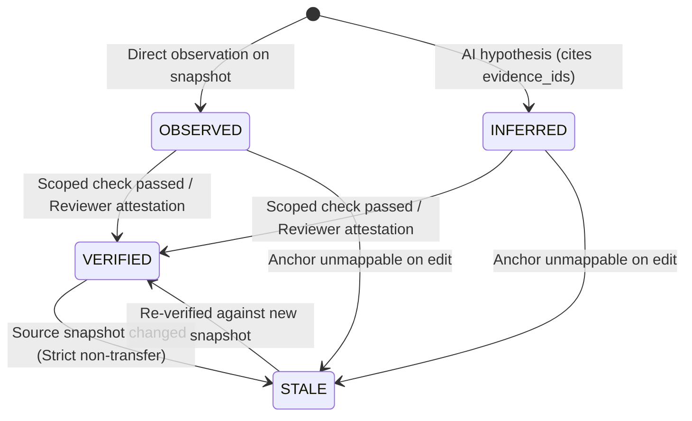

# Sokół Versioned Project Memory Specification (`sokol.fact.v1`)

**Status:** 🟢 **DELIVERED (Sokół Step 2 & 4 Prototype)**

## 1. Purpose & Core Guarantees

Sokół Project Memory provides a deterministic, version-scoped knowledge base for facts, structural findings, and AI hypotheses. It bridges the gap between raw analysis snapshots and long-lived code understanding while enforcing strict epistemic integrity and privacy boundaries.

### Guarantees
1. **Content-Addressed Immutability:** Every fact is assigned a content-derived `fact_id` (`fact:sha256:...`) computed over its canonical JSON envelope. Any modification to the claim, node anchor, evidence citations, or snapshot IDs invalidates the checksum.
2. **Snapshot-Bound Lifetime:** Every fact is bound to an exact `source_snapshot` SHA-256 hash and optional `graph_snapshot` digest.
3. **Strict Non-Transfer of Verification:** A `VERIFIED` fact **never** silently transfers its verified status to a modified code revision. Upon any change to the source snapshot, all `VERIFIED` facts are automatically transitioned to `STALE` with `staleness_reason = "snapshot_changed_reverification_required"`.
4. **Anchor Remapping Across Revisions:** Node anchors (`NodeAnchor`) track structural coordinates (paragraph name, statement index, verb, and signature) instead of volatile line numbers, enabling deterministic tracking across code additions and shifts.
5. **Zero Source / Value Leakage:** Claims and anchors cannot contain raw multi-line division headers or runtime variable states.

---

## 2. Envelope Specification (`sokol.fact.v1`)

```json
{
  "schema_version": "sokol.fact.v1",
  "fact_id": "fact:sha256:d8b24ef0368a...",
  "status": "INFERRED",
  "claim": "WS-RETRY-COUNT guards payment clearance retry recursion in 2000-EXECUTE-CLEARING-CYCLE",
  "evidence_ids": [
    "sha256:4b910ca840899f8d..."
  ],
  "source_snapshot": "c869e9f2913e6a987d6118d033fa29906d4e5f7a01c4e92a83e0c03429399859",
  "git_commit": "89945e8",
  "graph_snapshot": "fa0b2b8d035e1654157d60914ec7b8e1f0e42d7658c148c34f3b7bca06ee3dbb",
  "node_anchor": {
    "paragraph": "2000-EXECUTE-CLEARING-CYCLE",
    "statement_index": 2,
    "verb": "IF",
    "signature": "IF WS-RETRY-COUNT < WS-MAX-RETRIES",
    "node_id": "2000-EXECUTE-CLEARING-CYCLE:L32_IF",
    "line": 32,
    "copybook": null,
    "copybook_line": null
  },
  "confidence": "high",
  "verification_basis": null,
  "created_at_utc": "2026-10-13T08:00:00Z",
  "stale": false,
  "staleness_reason": null
}
```

### Field Definitions

| Field | Type | Description |
|---|---|---|
| `schema_version` | String | Fixed literal: `"sokol.fact.v1"`. |
| `fact_id` | String | Format: `fact:sha256:<64-hex>`. SHA-256 over canonical JSON without `fact_id`, `stale`, and `staleness_reason`. |
| `status` | String | Epistemic status: `"OBSERVED"`, `"INFERRED"`, or `"VERIFIED"`. |
| `claim` | String | Human or AI-readable proposition (max 1,000 chars). Prohibits raw source division headers. |
| `evidence_ids` | Array[String] | SHA-256 references to `sokol.event.v1` evidence events. Mandatory (non-empty) for `INFERRED` facts. |
| `source_snapshot` | String | 64-character hexadecimal SHA-256 hash of the exact source code and copybooks. |
| `git_commit` | String / Null | Optional 7–64 char commit hex if caller supplies Git context. |
| `graph_snapshot` | String / Null | Canonical graph topology digest. |
| `node_anchor` | Object | Structural anchor mapping (`paragraph`, `statement_index`, `verb`, `signature`, `line`, `copybook`). |
| `confidence` | String | Subjective confidence or calibration grade (default `"unscored"`). |
| `verification_basis` | Object / Null | Mandatory when `status = "VERIFIED"`. Specifies `basis_type` (`"assertion_test"` or `"reviewer_attestation"`), `snapshot_id`, and reference. |
| `created_at_utc` | String | UTC ISO-8601 timestamp with `Z` suffix. |
| `stale` | Boolean | `true` if invalidated by code modification, anchor shift, or snapshot change. |
| `staleness_reason` | String / Null | Cause of invalidation (e.g. `"snapshot_changed_reverification_required"`, `"anchor_unmappable"`). |

---

## 3. Epistemic Lifecycle & Invalidation Rules



### Rules
1. **`OBSERVED`**: Fact directly extracted from compiler AST, `CobolRuntime` trace, or graph metrics on a named snapshot.
2. **`INFERRED`**: Unconfirmed hypothesis. **Must cite at least one `evidence_id`**.
3. **`VERIFIED`**: Validated by an explicit test assertion or named human attestation.
   - **Constraint**: Cannot exist with `verification_basis = null`.
   - **Invalidation**: On any `source_snapshot` modification, `reconcile_with_snapshot()` marks all `VERIFIED` facts as `stale = True` with `staleness_reason = "snapshot_changed_reverification_required"`. Verification **cannot be silently carried across edits**.
4. **Anchor Remapping**:
   - For `OBSERVED` and `INFERRED` facts, if paragraph and statement signature match in the new graph, the fact remains active (anchor line updated).
   - If the statement signature is modified or the paragraph removed, the fact is marked `stale = True` with `staleness_reason = "anchor_unmappable"`.

---

## 4. Storage & Capacity Limits

- Maximum facts per in-memory store: **2,048**.
- Maximum serialized payload: **10 MiB** (aligned with `MAX_SOURCE_BYTES`).
- Serialization formats: Validated JSON and single-line JSONL.
